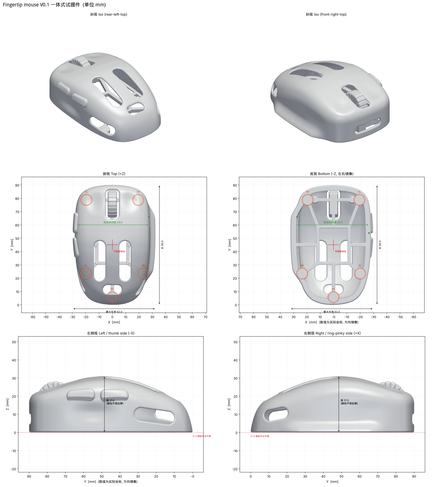

# 右手指握轻量化鼠标 · V0.1 一体式试握件

参数化生成的右手 fingertip（指握）鼠标外形试握模型。V0.1 把外壳、开放骨架、五个脚贴平台、主键触感面、侧键触感凸台和固定滚轮触感件做成**一个可打印实体**。这一版只用来试外形和能否够到各个键；电子元件装配版在此基础上再做。



## 交付物（`out/v0.1/`）

| 文件 | 说明 |
|---|---|
| `fingertip_v01_trial_grip.stl` / `.3mf` | **打印用**试握件，单位 mm，Z=0 为脚贴平台平面，按原朝向直接打印 |
| `outer_skin_nurbs_ref_v01.step` | 外形 NURBS 参考实体（只有外表面 + 平底，不含窗口、骨架和凸台），给 Fusion / SolidWorks 做装配版用 |
| `electronics_envelopes_v01.step` / `.stl` | 电子参考包络装配体（B-rep，按部件命名并着色；多数为**估计包络**） |
| `ref_skeleton_without_placeholders.stl` | 删除 V0.1 占位件（固定滚轮、主键受力柱）后的骨架，供装配版对照 |
| `main_board_keepin_outline.dxf` / `.csv` | 主板可用最大外形（按当前壳体内腔算出的上限，不是板型） |
| `report.json`、`检查报告.md` | 自动检查结果：尺寸、封闭/自相交、壁厚、五脚共面、接触区避让、干涉、重量 |
| `slice_report.json` | PrusaSlicer CLI 切片结果（含/不含支撑的耗材与时间） |
| `params_resolved.json` | 本次构建实际使用的参数（含尺寸自动校准后的值） |
| `img/` | 俯视、侧视、底视、斜视、接触区、壁厚、悬垂、内部包络和截面图 |

说明文档：

- [`docs/V0.1_设计说明.md`](docs/V0.1_设计说明.md)：设计依据、结构、检查结果、打印方法、电子包络与干涉、装配版待测尺寸
- [`docs/试握反馈表.md`](docs/试握反馈表.md)：试握时逐项记录
- [`docs/参考来源与许可.md`](docs/参考来源与许可.md)：实际查看过的参考文件、采用了什么、许可证

## 重新生成

```bash
pip install numpy scipy scikit-image trimesh manifold3d pymeshlab matplotlib cadquery ezdxf networkx
# 渲染需要 VTK（随 cadquery 安装）；无显示器的机器用 xvfb-run
xvfb-run -a python3 cad/build_v01.py --h 0.2 --out out/v0.1      # 4 核约 10 分钟，峰值内存约 5 GB
python3 cad/slice_v01.py out/v0.1/fingertip_v01_trial_grip.stl    # 需要 prusa-slicer
python3 cad/support_check.py out/v0.1/fingertip_v01_trial_grip.stl out/v0.1/slice_with_supports.gcode
python3 cad/make_report.py out/v0.1
# 快速预览（约 1 分钟）：
python3 cad/build_v01.py --h 0.4 --out /tmp/preview --no-render
```

所有尺寸和位置都在 [`cad/params_v01.py`](cad/params_v01.py)：长宽高、夹持宽、平面轮廓、驼峰曲线、主键指肚浅碟、拇指浅凹、无名指支撑、右侧托边、侧键、滚轮、壁厚、窗口、脚贴、传感器框、电子包络。
构建时先按目标尺寸自动校准（长 90 / 最大宽 62 / 夹持宽 54），高 31 由驼峰曲线直接给定。

## 坐标系

- X：向右为正（无名指/小指侧），X=0 为两主键中线
- Y：0 为最后端，向前为正（主键方向）
- Z：0 为五个脚贴平台的底面，向上为正；贴上脚贴后鼠标垫表面在 Z = −脚贴厚度

## 代码结构

| 文件 | 作用 |
|---|---|
| `cad/params_v01.py` | 全部参数（带来源标注的电子包络参数） |
| `cad/sdf.py` | 有符号距离场基础函数 |
| `cad/fingertip_mouse.py` | 外形、精确距离抽壳、窗口、骨架、脚贴、凸台、滚轮与占位件；尺寸校准 |
| `cad/checks.py` | 网格、自相交、五脚共面、壁厚、接触区避让、悬垂检查 |
| `cad/envelopes.py` | 电子参考包络、主板可用外形、干涉分析、STEP 导出 |
| `cad/skin_step.py` | 截面放样生成 NURBS 外形 STEP |
| `cad/render.py`, `cad/render_sheets.py` | 视图与图纸 |
| `cad/slice_v01.py`, `cad/prusa_v01.ini` | 切片估重 |
| `cad/support_check.py` | 解析 G-code，检查支撑是否接触外表面 |
| `cad/build_v01.py`, `cad/make_report.py` | 构建流程与报告 |

## 局限

- 手部数据只有照片 AR 粗测的手长约 230 mm、拇指到小指张开约 190 mm。掌宽、指节长度和真实握姿都还没测，所以**没有按手长缩放外形**，尺寸用的是给定的试握假设，需要试握后迭代。
- 主键、侧键、滚轮在 V0.1 中固定，不能评价点击力度和回弹。
- 电子包络大部分是估计值，**不能当装配尺寸或孔位用**。供体“ATK 蜻蜓 A1 Plus”的型号、传感器版本和主板外形尚未确认。
